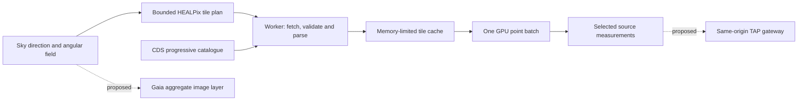

# Full Gaia catalogue access without a local mirror

Research and endpoint checks: **25 October 2026**. This document separates the working DR3 streaming implementation from proposed extensions. Service metadata and availability can change; the client validates its release contract before loading tiles.

## Recommended approach and current implementation

Use the public CDS progressive **catalogue** service to fetch source records for the current sky region, with a fixed browser memory and rendering budget. Keep the complete catalogue on the provider's servers. A separate Gaia angular survey avoids silently merging billions of source identities into the NASA catalogue.

The implementation in this branch provides this first stage through [gaia-hips.js](src/gaia-hips.js), [gaia-stream-worker.js](src/gaia-stream-worker.js), and [gaia-streamed-sky.js](src/gaia-streamed-sky.js): view-dependent HEALPix tile loading, worker parsing, bounded caching, source selection, and progressive detail as the view narrows. It uses native **ICRS directions at epoch J2016.0**. The existing audited bright-source merge in [DATA_GAIA_DR3.md](DATA_GAIA_DR3.md) remains separate.

The remote service reports coverage of **1,811,709,771 DR3 sources**. That is the available catalogue, not the number currently downloaded, drawn, or independently validated by this application. A wide view shows the provider's coarse, brightness-prioritized levels. Deeper tiles contribute additional sources. Source, tile, memory, and download limits remain explicit; the application must not describe a capped view as a complete extraction. [CDS catalogue properties](https://hipscat.cds.unistra.fr/HiPSCatService/I/355/gaiadr3/properties)

A Gaia density/flux background, arbitrary remote source-ID queries, and a physically navigable 3D Gaia octree are **proposed next stages**, not features delivered by this streaming client.

## Why the 10 TB archive does not have to be downloaded

The quoted 10 TB describes the complete DR3 release, including products beyond the few columns needed to draw a source. Nevertheless, even a hypothetical compact 32-byte visual record for each of 1,811,709,771 sources would require approximately **58 GB**, before spatial indices, metadata, GPU copies, and browser overhead. This is a calculation, not a measured catalogue file size. Full resident rendering is inappropriate even after aggressive column selection. ESA's release documentation distinguishes the much larger total release from its main source catalogues. [ESA DR4/DR3 data-volume comparison](https://www.cosmos.esa.int/web/gaia/dr4)

The practical meaning of full support is access to the complete remote source catalogue with progressive resolution and honest coverage information. It cannot mean holding one JavaScript object or one visible marker for every source simultaneously.

## Verified services

The following are provider-operated services, checked with small requests. No bulk catalogue or survey mirror was downloaded.

| Product | Verified endpoint | Role |
| --- | --- | --- |
| DR3 progressive source catalogue | [CDS HiPSCat](https://hipscat.cds.unistra.fr/HiPSCatService/I/355/gaiadr3/properties) | Individual sources, TSV tiles, equatorial frame, orders 1 through 11 |
| Catalogue schema | [metadata.xml](https://hipscat.cds.unistra.fr/HiPSCatService/I/355/gaiadr3/metadata.xml) | Column types, units, and native ICRS epoch |
| DR3 source density | [Density-map properties](https://alasky.cds.unistra.fr/ancillary/GaiaDR3/density-map/properties) | Aggregate sky coverage; not individually selectable source records |
| DR3 colour flux map | [Colour-map properties](https://alasky.cds.unistra.fr/ancillary/GaiaDR3/color-Rp-G-Bp-flux-map/properties) | Rp/G/Bp mapped to red/green/blue; image orders 0 through 7, 512-pixel JPEG tiles |
| Official row queries | [ESA TAP capabilities](https://gea.esac.esa.int/tap-server/tap/capabilities) | ADQL queries for specific sources, constrained regions, and richer measurements |
| Experimental columnar access | [CDS Gaia HATS index](https://vizcat.cds.unistra.fr/hats/gaia_dr3/) | Potential future server-side analysis and derived-product input; currently marked beta |

The HiPS catalogue, metadata, and image-properties responses returned `Access-Control-Allow-Origin: *`, so ordinary cross-origin browser GETs are viable. The independent browser smoke test should remain part of deployment validation; a header observed today is not an availability guarantee.

A bounded ESA TAP query for one known source returned a valid one-row VOTable, but **no CORS allow-origin header**, including when sent an `Origin` request header. Direct browser TAP access therefore cannot be assumed. The static catalogue renderer does not need TAP or a proxy; a future archive-query feature should use a controlled same-origin gateway or a separately verified CORS-enabled partner endpoint.

### Small-request measurements

These are observed payload sizes, not promises about every tile or network latency:

| Request | Uncompressed response observed | Contents |
| --- | ---: | --- |
| Catalogue `properties` | 793 bytes | Release and tiling contract |
| Catalogue `metadata.xml` | 47,163 bytes | Schema for 225 columns |
| `Norder1/Dir0/Npix0.tsv` | 20,047 bytes | 17 source records |
| `Norder2/Dir0/Npix0.tsv` | 10,876 bytes | 8 additional source records |
| Galactic-centre order 11 / pixel 29522077 | 32,471 bytes | 30 source records; one request measured 453 ms |
| Galactic-north order 11 / pixel 28825131 | HTTP 404 | Empty deeper cell; ancestor records still required |
| One-row ESA TAP query | 4,162 bytes | VOTable and field metadata |

The tested deep URLs are [Galactic-centre order 11](https://hipscat.cds.unistra.fr/HiPSCatService/I/355/gaiadr3/Norder11/Dir29520000/Npix29522077.tsv) and [Galactic-north order 11](https://hipscat.cds.unistra.fr/HiPSCatService/I/355/gaiadr3/Norder11/Dir28820000/Npix28825131.tsv). The tested coarse tile URLs are [order 1 / pixel 0](https://hipscat.cds.unistra.fr/HiPSCatService/I/355/gaiadr3/Norder1/Dir0/Npix0.tsv) and [order 2 / pixel 0](https://hipscat.cds.unistra.fr/HiPSCatService/I/355/gaiadr3/Norder2/Dir0/Npix0.tsv). The additional deep requests sampled directions near the Galactic centre and Galactic north pole. These isolated samples do not establish a maximum tile size or representative performance across the catalogue. The properties/schema/order-1 browser smoke test transferred 68,003 bytes in total and verified browser CORS access. The `Allsky.tsv` convenience response was stopped after a bounded preview; the implementation loads relevant tiles rather than assuming an all-sky response is small.

## Streaming design

HiPS uses nested HEALPix addressing. Catalogue refinement is additive: retain the selected region's ancestor records while loading its children. Image refinement is different: a finer image replaces its coarser footprint. Confusing these rules either drops bright catalogue sources or draws duplicates. The implementation deduplicates exact release-qualified source IDs and bounds traversal before requesting fine cells. The adopted protocol is the stable HiPS 1.0 Recommendation, rather than assuming support for a newer working draft. [IVOA HiPS Recommendation](https://ivoa.net/documents/HiPS/20170519/REC-HIPS-1.0-20170519.pdf)

Current application limits are engineering choices, not Gaia catalogue cuts:

| Resource | Initial policy |
| --- | --- |
| Resident rendered sources | 12,000 at high quality; 6,000 at low quality |
| Tile plan | At most 80 tiles including required ancestors |
| Concurrent tile downloads | At most 2 |
| Per-tile response | At most 2 MiB, enforced while reading the response |
| Application tile-cache budget | 24 MiB conservative accounting; the reusable client defaults to 32 MiB |
| Camera settling | Approximately 0.24 seconds before scheduling a changed region |
| Worker updates | Coalesced over 250 ms; no archive query for every rendered frame |
| Timeout | 15 seconds per request |
| Service failure | Global cooldown, respecting bounded `Retry-After`; no automatic request loop |

The cache accounts conservatively for text and parsed records, evicts unused tiles, and refuses additional resident data when the active working set does not fit. Raw 225-column TSV is not kept indefinitely. Decoding and row selection happen off the render thread; only needed fields are retained. A failed request keeps already loaded data available. A missing tile is empty coverage; a rate-limit response is a service failure, not an empty sky.

When the source budget is reached, narrowing the field should allow the same budget to represent more detail. The interface distinguishes coarse progressive detail, source-cap truncation, memory limits, loading, and failure. These limits do not establish a scientifically complete sample. Complete region export requires a different query path and a count/completeness check.

### Proposed all-sky aggregate layer

A source-density or flux HiPS background would represent the unresolved population at wide fields of view while the individual-source renderer refines the selected region. Use the existing CDS products rather than inventing faint background stars. Label density, flux, and assigned-colour products accurately; they are not equivalent to a photograph or a physical volumetric reconstruction.

Keep a coarse all-sky image resident, refine visible image tiles with an independent texture budget, and blend refinement without changing source positions. A suggested starting budget is 16-32 MiB of incremental GPU textures on a headset, to be measured alongside the existing planet assets. This is a proposal, not a tested Quest budget. The colour product declares CDS attribution and ODbL-1.0; preserve its published attribution and evaluate licence obligations before redistributing modified tiles. [CDS colour-map metadata](https://alasky.cds.unistra.fr/ancillary/GaiaDR3/color-Rp-G-Bp-flux-map/properties)

## Coordinate, identity, and measurement rules

The streamed survey uses native `RAdeg`/`DEdeg`, in degrees at J2016.0. It retains proper motion in mas/year and parallax/error in mas, including null and negative values. `Source` stays a decimal string: many Gaia identifiers exceed JavaScript's exact integer range. G, BP, and RP magnitudes retain their band identities. Candidate quasar/galaxy flags remain data, rather than being erased by classifying every Gaia source as a confirmed star. [CDS DR3 ReadMe](https://cdsarc.cds.unistra.fr/ftp/I/355/ReadMe)

The CDS tables also contain added `RAJ2000`/`DEJ2000` columns. The new survey does **not** use these for display or cone filtering: at fine zoom a high-proper-motion source can leave the native-epoch tile footprint. A future epoch slider needs a justified proper-motion search margin or an index built for that epoch. Changing point coordinates alone is insufficient.

A metadata discrepancy was observed: `metadata.xml` labels `dHIP` as mas, but the catalogue ReadMe specifies arcseconds. The test source `8900825800310016` has tile `dHIP = 0.156405`, matching the existing ESA archive snapshot's `angularDistanceArcsec = 0.15640457`. The parser follows the documented arcsecond field and records the discrepancy in code. These HIP links are retained as reported associations, not automatically approved merges.

The separate survey prevents duplicate Gaia/NASA markers in the same layer and leaves the existing conservative bright-source matching unchanged. Any future unified renderer should use official cross-match tables, multiplicity flags, release-qualified identities, and reversible provenance. Proximity, a familiar star name, or a single association in a restricted sample is insufficient to establish unique physical identity. [ESA Hipparcos-2 cross-match model](https://gea.esac.esa.int/archive/documentation/GDR3/Gaia_archive/chap_datamodel/sec_dm_cross-matches/ssec_dm_hipparcos2_best_neighbour.html)

## Rich queries and a production backend

Do not run TAP cone searches while the user turns their head. Reserve TAP for explicit source details, a constrained search, or a deliberately requested region export. Select only required columns and specify limits. Use asynchronous jobs for work that genuinely needs them; cancel jobs that are no longer required, poll with backoff, and delete job results after use. The existing source-ID strings must remain exact when constructing and parsing archive queries. [ESA programmatic access](https://www.cosmos.esa.int/web/gaia-users/archive/programmatic-access)

The public ESA `/capabilities` response observed during this study advertises a 50,000-row output default/hard limit, a 3,600-second execution limit, and 129,600-second retention. These advertised values are not a promise that every anonymous query will run to those limits. Deployment must inspect current capabilities and [account-specific quotas](https://www.cosmos.esa.int/web/gaia-users/archive/collaborate#GaiaArchiveUserQuotas).

A TAP response can be truncated even when its HTTP request succeeds. Validate the VOTable's initial and trailing `QUERY_STATUS`; never treat a successful `TOP N` query as proof of a complete region. Exports require a matched count or otherwise explicit completeness evidence. [IVOA TAP 1.1](https://www.ivoa.net/documents/TAP/20190927/REC-TAP-1.1.html)

If production usage grows, add a small same-origin gateway for query allowlisting, shared caching, request coalescing, timeouts, and quotas. A source-details endpoint should accept validated identifiers and fixed fields, not arbitrary anonymous ADQL. This gateway need not store the catalogue. A separately agreed derived tile service could project the 225-column rows into compact binary records, but that is a hosting and data-distribution project, not a reason to download 10 TB to a development PC.

The current catalogue is marked `unclonable`. CDS's HATS prototype explicitly warns against harvesting large catalogues without provider consent. The application therefore requests only viewed regions and keeps a bounded working cache; it must not recursively prefetch every sky cell. HATS may later support server-side columnar analyses or derived products, but its current beta status and harvesting restrictions make it unsuitable as an unexamined bulk-download shortcut. [CDS HATS prototype](https://vizcat.cds.unistra.fr/hats/gaia_dr3/), [CDS catalogue record](https://cdsarc.cds.unistra.fr/viz-bin/cat/I/355)

## Physical 3D navigation requires a second spatial index

Sky tiles are an angular index, not a physical-distance index. They cannot efficiently answer which nearby stellar volumes intersect a camera located far from Earth. For an actual 3D Gaia volume, build a separate octree or comparable spatial hierarchy with progressive samples, immutable binary nodes, projected-error selection, bounded GPU residency, and a cache around the viewer. A backend or published derived dataset supplies these nodes; the browser streams them on demand. Gaia Sky demonstrates an octree-based level-of-detail design for catalogues larger than resident memory. [Gaia Sky LOD documentation](https://gaia.ari.uni-heidelberg.de/gaiasky/docs/3.0.0/Data-streaming.html)

The distance model is a scientific dependency. Missing or negative parallax must not be replaced with a made-up radius merely to include a source in the 3D volume. Use attributed distance estimates and uncertainties where available, and keep unresolved sources in the angular catalogue. A quality-selected distance volume cannot truthfully be called a physical 3D reconstruction of every Gaia source. Published geometric and photogeometric distances have different priors and limitations; simple inverse parallax is not a universal substitute. [Distance-catalogue author guidance](https://bailer-jones.www3.mpia.de/gedr3_distances/FAQ.html), [Gaia astrometric documentation](https://gea.esac.esa.int/archive/documentation/GDR3/)

For headset rendering, retain a fixed tracked camera, stream both eyes' visible regions together, and let detail change through fading rather than moving sources between arbitrary depths. Benchmark source density, GPU upload time, stereo frame time, and garbage-collection stalls on a physical Quest before raising budgets.

## DR4 preparation

The live ESA release page checked on 25 October 2026 schedules **DR4 for 2 December 2026**. Its updated contents page describes approximately **400 TB**, about **2.8 billion processed sources** across products, a high-quality `gaia_source` subset of about **2 billion**, and reference epoch **J2017.5**. Older cached pages quoting 500 TB or 2.7 billion are not the current source used here. All of these remain release planning information until publication. [ESA release schedule](https://www.cosmos.esa.int/web/gaia/release), [ESA DR4 contents](https://www.cosmos.esa.int/web/gaia/dr4)

Do not implement DR4 by replacing `dr3` in a URL. Keep release, catalogue identity, endpoint, epoch, field schema, coordinate frame, units, coverage, and licence in a versioned manifest. Use `(release, source_id)` as the identity and cache key, and preserve original IDs through any official inter-release cross-match. DR4's separate source products require an explicit scope decision; `gaia_source` alone no longer means every processed source. Re-run metadata, coordinate, multiplicity, and completeness checks against the published products before enabling the release.

## Validation and remaining work

The client tests cover bounded HEALPix plans at wrap/poles, additive ancestors, exact 64-bit IDs, null/negative measurements, native-epoch filtering, metadata mismatches, cancellation and late responses, source/memory/download budgets, missing tiles, timeouts, and global service backoff. Live smoke checks use properties, schema, and one small tile; deterministic browser tests should mock service responses rather than repeatedly query the archive.

Before claiming a complete finest-resolution region, compare the union of its ancestor/leaf source IDs against a bounded authoritative extraction in both sparse and crowded fields. Include missing-G sources, binaries, ambiguous cross-matches, and sources with high proper motion. Record any oversized tile or cap as incomplete coverage. Measure cache reuse and requests during fast panning and ensure leaving the view stops further downloads.

Physical Quest performance remains a device test. Aggregate imagery, unrestricted source-ID search, a production gateway, exhaustive regional completeness auditing, and the physical 3D hierarchy remain follow-up work. The current implementation establishes usable on-demand access to the full DR3 progressive catalogue without a local mirror, while keeping its visible sample and resource limits explicit.
